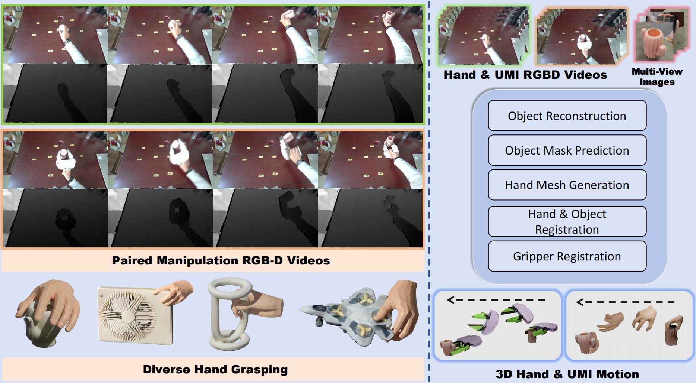
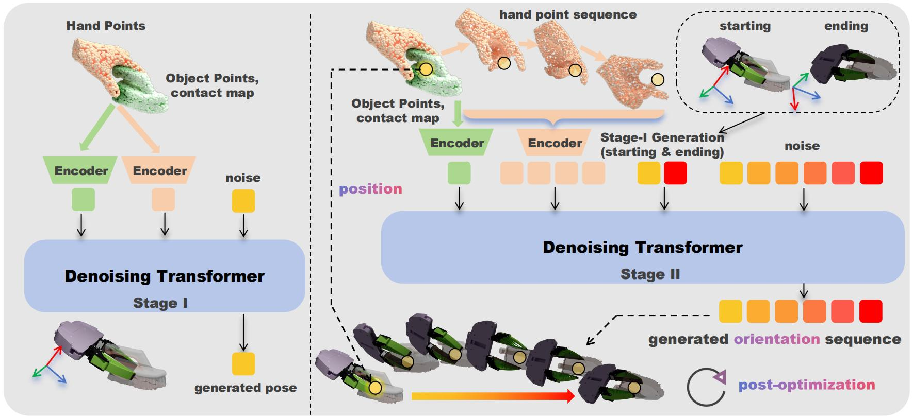

# CosmoH2G: Hand-to-Gripper Transfer for Complex Spatial Manipulation

<p align="center">
  <a href="https://cosmoh2g.github.io/"></a>
  <a href="https://arxiv.org/abs/2609.07498"></a>
</p>

<p align="center">
  <b>CosmoH2G</b> transfers complex spatial hand demonstrations to robotic grippers<br>
  through a two-stage, data-driven framework.
</p>

---

<p align="center">
  
  
</p>

<p align="center">
  <b>Left:</b> Dataset — 6,189 episodes · 1,254 objects &nbsp;|&nbsp;
  <b>Right:</b> Method — Stage-I keyframes → Stage-II full sequence
</p>

## Data Processing

### Data Format

Each case directory contains:

```text
case/
├── start_obj_mask.jpg
├── end_obj_mask.jpg
├── gripper_base_mask.jpg
└── table_mask.jpg
```

`start_obj_mask.jpg` and `end_obj_mask.jpg` mark the object on the first and last frames. `gripper_base_mask.jpg` marks the gripper base. `table_mask.jpg` marks the table. Camera intrinsics shared by these captures are in `haptic/cam_K.txt`. Gripper meshes are `/mnt/CosmoH2G/umi.obj` and `/mnt/CosmoH2G/umi_base.obj`. Sequence paths and these files are passed in by the user.

### Hand Reconstructing and Tracking

We reconstruct the hand in every case with [HaPTIC](https://github.com/JudyYe/haptic), then align the reconstructed hand meshes into the 3D scene through depth ICP.

#### Environment

Run inside the `haptic` conda environment, from the `haptic/` directory.

```bash
conda create -n haptic python=3.10 -y
conda activate haptic
cd haptic
bash scripts/one_click.sh
```

`scripts/one_click.sh` installs dependencies and downloads the HaPTIC pretrained weights. Download the MANO model from the [MANO website](https://mano.is.tue.mpg.de/) and place it under `haptic/assets/mano/`.

#### Run

Pass the RGB directory, the depth directory, and the output directory.

```bash
cd haptic
conda activate haptic

python process_hand_worker.py \
    --rgb /path/to/color \
    --depth /path/to/depth \
    --output /path/to/output \
    --cam-k cam_K.txt
```

| Argument | Default | Description |
|----------|---------|-------------|
| `--rgb` | | RGB frame directory |
| `--depth` | | Depth frame directory |
| `--output` | | Writes `haptic_out/` and `haptic_align_out/` here |
| `--cam-k` | `cam_K.txt` | Camera intrinsics |

### 2. Registering the Starting and Ending poses of Object

Run from `FoundationPose-plus-plus/`. Installation is described in [FoundationPose-plus-plus/Install.md](FoundationPose-plus-plus/Install.md). This step registers the starting frame and the ending frame, and estimates the object scale first.

```bash
cd FoundationPose-plus-plus

bash process_obj.sh \
    --start-rgb /path/to/start.jpg \
    --end-rgb /path/to/end.jpg \
    --start-depth /path/to/start.raw \
    --end-depth /path/to/end.raw \
    --mesh /path/to/mesh.obj \
    --start-mask /path/to/start_obj_mask.jpg \
    --end-mask /path/to/end_obj_mask.jpg \
    --output /path/to/output
```

Outputs are `obj_scale.txt`, `start_obj_pose.npy`, `end_obj_pose.npy`, `start_obj_track/`, and `end_obj_track/` under `--output`.

### 3. Tracking Gripper Motions

Tracks the gripper base over one RGB and depth sequence.

```bash
cd FoundationPose-plus-plus

bash process_gripper.sh \
    --rgb /path/to/color \
    --depth /path/to/depth \
    --mask /path/to/gripper_base_mask.jpg \
    --mesh /path/to/umi_base.obj \
    --output /path/to/output
```

Outputs are `base_pose.npy` and `base_track/` under `--output`.

## Citation

```bibtex
@misc{zhao2026cosmoh2ghandtogrippertransferdataset,
      title={CosmoH2G: A Hand-to-Gripper Transfer Dataset and Baseline Method for Object Manipulation with Complex Spatial Movements}, 
      author={Hongxiang Zhao and Mutian Xu and Zeyu Jin and Yiming Hao and Shuguang Cui and Xiaoguang Han},
      year={2026},
      eprint={2609.07498},
      archivePrefix={arXiv},
      primaryClass={cs.RO},
      url={https://arxiv.org/abs/2609.07498}, 
}
